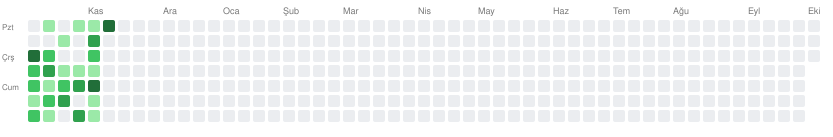

# 🛡️ Bug Bounty Journey

> Sıfırdan etik hacker'lığa / bug bounty avcılığına uzanan kişisel öğrenme yolculuğunun günlüğü.

**Başlangıç:** 06.10.2026 · **Bir yıllık kontrol noktası:** 06.10.2027

---

## 🗓️ Aktivite Haritası



> Commit geçmişinden üretilen anlık aktivite haritası (periyodik tazelenir).

**Başlangıç:** 06.10.2026 · **Gün:** 37. · **Aktif gün:** 29 (%78) · **Çözülen lab:** 36 · **Aktif güne ort.:** 1.2 lab

## 🎯 Öncelik Sırası (sahaya hazırlık)

Gerçek VDP/bug bounty'de **frekans × bulunabilirlik × etki**'ye göre; en çok zamanı en üstteki tier'a ver. (Genel müfredat aşağıda tam duruyor — bu, *günlük seçimi* yönlendirir, "boşa kürek" olmasın.)

- **🥇 Tier 1 (en çok zaman):** XSS · Access Control/IDOR · Information Disclosure · CSRF · SSRF · Business Logic
- **🥈 Tier 2:** Authentication · Open Redirect · File Upload · Path Traversal · SQLi · API/GraphQL · Security Misconfiguration
- **🥉 Tier 3 (niş, yüksek değer, ileride):** Command Injection/RCE · XXE · SSTI · Insecure Deserialization · JWT/OAuth · HTTP Request Smuggling · Web Cache Poisoning · Prototype Pollution · Race Conditions

*Kaynak: HackerOne Top 10 + Bugcrowd/sektör trendi (frekans yıla göre oynar).* Offensive/RCE sevgisi Tier 3'te — derinlik/yüksek değer için saklı; ekmek Tier 1'den.

---

## 📊 Scoreboard

### ✅ Toplam Çözülen Lab: **36**

Konu bazında **çözülen** lab sayısı (PortSwigger müfredatının tamamı; her konunun çok daha fazla lab'ı var — bu tablo "neye dokundum / ne kaldı" haritası).

**🖥️ Server-side**
| Konu | Çözülen | Durum |
|------|:-------:|-------|
| SQL Injection | 11 | 🔄 devam |
| Access Control / IDOR | 8 | 🔄 devam |
| SSRF | 4 | 🔄 devam |
| Authentication | 1 | 🔄 devam |
| OS Command Injection | 1 | 🔄 devam |
| Path Traversal | 0 | ⏳ sırada |
| File Upload | 0 | ⏳ sırada |
| Business Logic | 0 | ⏳ sırada |
| Information Disclosure | 2 | 🔄 devam |
| XXE Injection | 0 | ⏳ sırada |
| NoSQL Injection | 0 | ⏳ sırada |
| Race Conditions | 0 | ⏳ sırada |
| API Testing | 0 | ⏳ sırada |

**🌐 Client-side**
| Konu | Çözülen | Durum |
|------|:-------:|-------|
| Cross-Site Scripting (XSS) | 7 | 🔄 devam |
| CSRF | 2 | 🔄 devam |
| CORS | 0 | ⏳ sırada |
| Clickjacking | 0 | ⏳ sırada |
| WebSockets | 0 | ⏳ sırada |

**🧩 İleri seviye**
| Konu | Çözülen | Durum |
|------|:-------:|-------|
| JWT | 0 | ⏳ sırada |
| OAuth | 0 | ⏳ sırada |
| Insecure Deserialization | 0 | ⏳ sırada |
| HTTP Host Header | 0 | ⏳ sırada |
| HTTP Request Smuggling | 0 | ⏳ sırada |
| Web Cache Poisoning | 0 | ⏳ sırada |
| Prototype Pollution | 0 | ⏳ sırada |
| GraphQL | 0 | ⏳ sırada |
| Web LLM Attacks | 0 | ⏳ sırada |

> ~25 konudan **6'sı başladı.** Hem genişlik hem derinlik önde — 35. gün için sağlam bir başlangıç, "bitmek üzere" değil.

### 🧭 İlerleme

- [x] **Temeller** — Web/HTTP/DNS, oturum (session), Burp Suite
- [x] **Etik çizgi** — scope & yetki refleksi
- [x] **Access Control / IDOR** — veri + işlev/rol ekseni, IDOR + password disclosure (8 lab)
- [ ] **XSS** — context'ler: HTML ✅, attribute ✅, JS string ✅, DOM ✅ · (stored-ileri, filtre atlatma sürüyor)
- [ ] **SQL Injection** — hidden data ✅, login bypass ✅, UNION ✅, DB fingerprint ✅, yapı keşfi ✅, **blind tam** (responses + errors + time + info-retrieval) ✅ (+Python) · (filtre/WAF atlatma, OAST sürüyor)
- [ ] **SSRF** — localhost ✅, iç ağ tarama ✅, blacklist ✅, whitelist atlatma (Expert) ✅ · (devam ediyor)
- [ ] **OS Command Injection** — simple case (RCE, whoami) ✅ · (blind sürüyor)
- [ ] **Authentication** — username enumeration + brute-force (Python) ✅ · (devam ediyor)
- [ ] **Information Disclosure** — error message (sürüm) ✅ + backup file (kaynak kod + DB parola) ✅ · (devam ediyor)
- [ ] **CSRF** — no-defenses ✅ + token bypass (token varken yok sayınca atlanıyor) ✅ · (devam ediyor)
- [ ] **CSRF**
- [ ] **Python ile otomasyon** (payload/recon)

---

## 🎯 Hedef

Web uygulama güvenliğinde sağlam bir temel kurup, izinli ve etik sınırlar içinde (bug bounty programları + yasal lab'lar) zafiyet avcılığı yapabilecek seviyeye gelmek.

**Felsefe:** Hedef bug bounty (motivasyon), günlük iş ise basamakları sırayla ve sindirerek geçmek. Para, bilginin doğal sonucudur. 100 kiloyu bir kere değil, 1 kiloyu 100 kere.

## 🗺️ Yol Haritası

1. **Temeller** — İnternet/web nasıl çalışıyor (HTTP, DNS, oturum)
2. **Araçlar** — Burp Suite başta olmak üzere
3. **Zafiyet sınıfları** — OWASP Top 10 ve ötesi (IDOR, XSS, SQLi, SSRF...)
4. **Pratik** — PortSwigger Academy, TryHackMe, HackTheBox (yasal lab'lar)
5. **Gerçek sahne** — HackerOne, Bugcrowd, Intigriti

**Bilgi basamakları:** Ağ + Linux temelleri → Web uygulama güvenliği (OWASP + Burp) → Bir alanda uzmanlaşma
**Sertifika hedefi (şimdilik):** BSCP (Burp Suite Certified Practitioner)

---

## 📁 Repo Yapısı

```
.
├── temeller/                     platform-bağımsız bilgi (konseptler)
├── web-security/
│   └── portswigger/              platform
│       ├── access-control/       konu
│       ├── cross-site-scripting/ konu
│       ├── sql-injection/         konu
│       ├── ssrf/                  konu
│       ├── os-command-injection/  konu
│       └── authentication/        konu
└── ilerleme/                     milestone öz-değerlendirmeleri
```

İleride TryHackMe, HackTheBox gibi platformlar `web-security/` altına; web dışı alanlar ise `web-security`'nin kardeşi olarak eklenir.

## 📚 Temeller (platform-bağımsız)

Her yeni konuya geçmeden önce ilgili dosyayı bir oku, tekrar et, sonra devam et.

| # | Konu | Dosya |
|---|------|-------|
| 1 | Web Nasıl Çalışır? (İstek/Yanıt Döngüsü) | [temeller/01-web-nasil-calisir.md](./temeller/01-web-nasil-calisir.md) |
| 2 | HTTP İsteğinin Anatomisi | [temeller/02-http-istegi-anatomisi.md](./temeller/02-http-istegi-anatomisi.md) |
| 3 | Oturum (Session) Mantığı | [temeller/03-oturum-session-mantigi.md](./temeller/03-oturum-session-mantigi.md) |
| 4 | IDOR (kavram) | [temeller/04-idor.md](./temeller/04-idor.md) |
| 5 | Burp Suite (İsteği Havada Yakalamak) | [temeller/05-burp-suite.md](./temeller/05-burp-suite.md) |
| ⚖️ | Etik Çizgi (her zaman cepte) | [temeller/etik-cizgi.md](./temeller/etik-cizgi.md) |

## 🧪 Lab Çözümleri — web-security / portswigger

### Access Control

| # | Lab | Dosya |
|---|-----|-------|
| 1 | Insecure direct object references | [01-insecure-direct-object-references.md](./web-security/portswigger/access-control/01-insecure-direct-object-references.md) |
| 2 | User ID controlled by request parameter | [02-user-id-request-parameter.md](./web-security/portswigger/access-control/02-user-id-request-parameter.md) |
| 3 | ...with unpredictable user IDs | [03-unpredictable-ids.md](./web-security/portswigger/access-control/03-unpredictable-ids.md) |
| 4 | ...with data leakage in redirect | [04-data-leakage-redirect.md](./web-security/portswigger/access-control/04-data-leakage-redirect.md) |
| 5 | Unprotected admin functionality | [05-unprotected-admin.md](./web-security/portswigger/access-control/05-unprotected-admin.md) |
| 6 | Unprotected admin functionality with unpredictable URL | [06-admin-url-js-leak.md](./web-security/portswigger/access-control/06-admin-url-js-leak.md) |
| 7 | User role controlled by request parameter | [07-role-cookie.md](./web-security/portswigger/access-control/07-role-cookie.md) |
| 8 | User ID param + password disclosure (IDOR zinciri) | [08-user-id-param-password-disclosure.md](./web-security/portswigger/access-control/08-user-id-param-password-disclosure.md) |

### Cross-Site Scripting (XSS)

| # | Lab | Dosya |
|---|-----|-------|
| 1 | Reflected XSS — HTML context, nothing encoded | [01-reflected-html-context.md](./web-security/portswigger/cross-site-scripting/01-reflected-html-context.md) |
| 2 | Stored XSS — HTML context, nothing encoded | [02-stored-html-context.md](./web-security/portswigger/cross-site-scripting/02-stored-html-context.md) |
| 3 | Reflected XSS — attribute, angle brackets encoded | [03-attribute-angle-brackets-encoded.md](./web-security/portswigger/cross-site-scripting/03-attribute-angle-brackets-encoded.md) |
| 4 | Reflected XSS — JavaScript string breakout | [04-javascript-string-breakout.md](./web-security/portswigger/cross-site-scripting/04-javascript-string-breakout.md) |
| 5 | DOM XSS — document.write sink (source: location.search) | [05-dom-xss-document-write.md](./web-security/portswigger/cross-site-scripting/05-dom-xss-document-write.md) |
| 6 | DOM XSS — innerHTML sink (source: location.search) | [06-innerhtml-sink.md](./web-security/portswigger/cross-site-scripting/06-innerhtml-sink.md) |
| 7 | Anchor href — javascript: şeması (breakout kapalı) | [07-href-javascript-scheme.md](./web-security/portswigger/cross-site-scripting/07-href-javascript-scheme.md) |

### SQL Injection

| # | Lab | Dosya |
|---|-----|-------|
| 1 | SQLi in WHERE clause — retrieving hidden data | [01-where-clause-hidden-data.md](./web-security/portswigger/sql-injection/01-where-clause-hidden-data.md) |
| 2 | SQLi authentication / login bypass | [02-login-bypass.md](./web-security/portswigger/sql-injection/02-login-bypass.md) |
| 3 | UNION attack — sütun sayısını belirleme | [03-union-determine-columns.md](./web-security/portswigger/sql-injection/03-union-determine-columns.md) |
| 4 | UNION attack — metin tutan sütunu bulma | [04-union-find-text-column.md](./web-security/portswigger/sql-injection/04-union-find-text-column.md) |
| 5 | UNION attack — başka tablodan veri çekme | [05-union-retrieve-data.md](./web-security/portswigger/sql-injection/05-union-retrieve-data.md) |
| 6 | Examining DB — tür/sürüm belirleme (Oracle) | [06-db-version-oracle.md](./web-security/portswigger/sql-injection/06-db-version-oracle.md) |
| 7 | Examining DB — yapıyı kazıma (information_schema) | [07-listing-db-contents-non-oracle.md](./web-security/portswigger/sql-injection/07-listing-db-contents-non-oracle.md) |
| 8 | Blind — conditional responses (+Python) | [08-blind-conditional-responses.md](./web-security/portswigger/sql-injection/08-blind-conditional-responses.md) |
| 9 | Blind — conditional errors (Oracle, +Python) | [09-blind-conditional-errors.md](./web-security/portswigger/sql-injection/09-blind-conditional-errors.md) |
| 10 | Blind — time delays (PostgreSQL) | [10-blind-time-delays.md](./web-security/portswigger/sql-injection/10-blind-time-delays.md) |
| 11 | Blind — time delays + info retrieval (PostgreSQL, +Python) | [11-blind-time-delays-info-retrieval.md](./web-security/portswigger/sql-injection/11-blind-time-delays-info-retrieval.md) |

### SSRF

| # | Lab | Dosya |
|---|-----|-------|
| 1 | Basic SSRF against the local server | [01-basic-ssrf-localhost.md](./web-security/portswigger/ssrf/01-basic-ssrf-localhost.md) |
| 2 | Basic SSRF against another back-end system (iç ağ tarama) | [02-against-backend-system.md](./web-security/portswigger/ssrf/02-against-backend-system.md) |
| 3 | SSRF — blacklist (filtre) atlatma | [03-blacklist-filter-bypass.md](./web-security/portswigger/ssrf/03-blacklist-filter-bypass.md) |
| 4 | SSRF — whitelist atlatma (parser disagreement) | [04-whitelist-filter-bypass.md](./web-security/portswigger/ssrf/04-whitelist-filter-bypass.md) |

### OS Command Injection

| # | Lab | Dosya |
|---|-----|-------|
| 1 | OS command injection, simple case (RCE) | [01-simple-case.md](./web-security/portswigger/os-command-injection/01-simple-case.md) |

### Authentication

| # | Lab | Dosya |
|---|-----|-------|
| 1 | Username enumeration via different responses (+Python) | [01-username-enumeration-different-responses.md](./web-security/portswigger/authentication/01-username-enumeration-different-responses.md) |

### Information Disclosure

| # | Lab | Dosya |
|---|-----|-------|
| 1 | Information disclosure in error messages | [01-infoleak-in-error-messages.md](./web-security/portswigger/information-disclosure/01-infoleak-in-error-messages.md) |
| 2 | Source code disclosure via backup files | [02-source-code-disclosure-via-backup-files.md](./web-security/portswigger/information-disclosure/02-source-code-disclosure-via-backup-files.md) |

### CSRF

| # | Lab | Dosya |
|---|-----|-------|
| 1 | CSRF vulnerability with no defenses | [01-csrf-no-defenses.md](./web-security/portswigger/csrf/01-csrf-no-defenses.md) |
| 2 | Token validation depends on token being present (token bypass) | [02-token-validation-depends-on-token-being-present.md](./web-security/portswigger/csrf/02-token-validation-depends-on-token-being-present.md) |

## 🏆 Çözülen Lab'lar

Tam kronolojik liste (uzadıkça README şişmesin diye ayrı dosyada): **[ilerleme/lab-gunlugu.md](./ilerleme/lab-gunlugu.md)**

Konu bazlı listeler yukarıda; güncel toplam scoreboard'da.

## 📈 Öz-değerlendirme (milestone)

Belirli aralıklarla kısa öz-değerlendirme; sonraki milestone'da kıyaslamak için.

| Gün | Not |
|-----|-----|
| 25 | [gun-25-degerlendirme.md](./ilerleme/gun-25-degerlendirme.md) |

**İlgi pusulası (hangi alana yatkınım):** [ilgi-pusulasi.md](./ilerleme/ilgi-pusulasi.md)

## 🔜 Sıradaki Adım

- **OS Command Injection:** blind (output yönlendirme, time delay, OAST)
- **SSRF:** kalan türler (open-redirect ile atlatma, blind SSRF)
- **Information Disclosure:** diğer sızıntı türleri (debug sayfası, yedek/kaynak dosya, versiyon kontrol, HTTP TRACE)
- **CSRF:** token bypass türleri (token var ama doğrulanmıyor, method değişimi, SameSite atlatma, Referer kontrolü zayıflığı)
- **Yeni sınıflar:** Business Logic, file upload, path traversal (Tier-1/2 öncelikli)

## 🌉 Lab → Gerçek Hedefe Geçiş (köprü)

Hedef (06.10.2027): **ilk geçerli VDP raporu** — para değil, valid bulgu. Önce para ödülsüz, saygınlık veren VDP'ler.

- **Recon & Metodoloji modülü:** scope okuma, subdomain enumeration, content discovery, uygulama haritalama; recon tooling (subfinder, httpx, ffuf, nuclei) + Burp'te derinleşme. (Lab zafiyetin yerini verir; gerçek hedefte yeri SEN bulacaksın.)
- **Haftada 1 disclosed report** (HackerOne Hacktivity) — birlikte okuyup çıkarımı [ilerleme/disclosed-report-gunlugu.md](./ilerleme/disclosed-report-gunlugu.md)'ye yazıyoruz.
- **Haftada 1 OWASP analiz günü:** bir OWASP Top 10 kategorisini derinlemesine analiz + o kategoriye uygun lab'lar. (OWASP = sektörün ortak dili/çerçevesi — bilmek şart; bug-bulma checklist'i değil, risk haritası.)
- **Odak dengesi:** pusula offensive'i gösteriyor; ama acemi için "kolay gerçek bulgular" genelde **IDOR / info disclosure** — onları da güçlendir.
- **Zihin:** gerçek hedefte günlerce boş dönmek normaldir; dayanıklılık da bir beceri.

---

*Bu repo bir öğrenme günlüğüdür; içinde gerçek hedeflere dair somut zafiyet bilgisi barındırmaz, yalnızca genel öğrenme notları içerir.*
