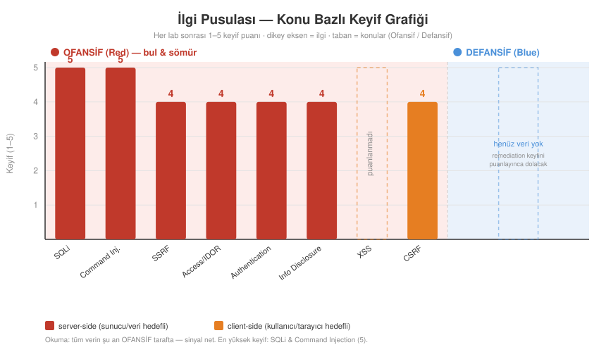

# İlgi Pusulası — hangi alana yatkınım?

> Amaç: "her şeye ilgim var" belirsizliğini, zamanla **keyif verisiyle** çözmek. Zorla alan seçmek yok; neyi yaparken "aktığım" biriktikçe uzmanlaşma kendini gösterir. Her lab sonrası kısa bir keyif notu; her milestone'da deseni okuruz.

## 📊 Grafik

> Dikey: keyif (1–5) · Taban: konular, **Ofansif (Red)** / **Defansif (Blue)** ayrımı · server-side (kırmızı) vs client-side (turuncu). Grafik her yeni puanla güncellenir.

## Siber güvenlik alanları (hepsi aynı temeli paylaşır)
- Offensive web / bug bounty · Network/infra pentest · Red team · Exploit dev / vuln research · Security tooling & automation · AppSec / secure code review · Blue team / DFIR

## İlk sinyal — Gün 27 (01.11.2026)
- "Erişilemez sanılan şeylere **erişmek**, sistemlere **girmenin yolunu bulmak** çok havalı geliyor." → *içeri girme / erişim* hazzı.
- Blind SQLi'de en sevdiği: **şifreyi ele geçirmek** (avın/trophy'nin kendisi).
- Angarya hissettiren kısım: yok.
- **Yorum:** sinyal **offensive/exploitation** tarafını işaret ediyor (bug bounty / pentest / red team'in "kırıp girme" hazzı) — CV'den beklenen tooling/AppSec tarafından farklı. Tek veri noktası, erken; biriktirince netleşecek.

## Keyif günlüğü (her lab: 1–5 + bir cümle)
| Lab | Keyif | En sevdiğim / en sıkıcı an |
|-----|:-----:|-----------------------------|
| Blind SQLi (genel: responses/errors/time) | 5 | Sevdi: şifreyi ele geçirme avı + script yazma. Angarya: yok. |
| SSRF #1 (basic, localhost) | 4 | Sevdi: sunucuyu kandırıp erişilemez admin paneline ulaşmak ("erişilemeze erişmek"). |
| SSRF #2 (iç ağ tarama) | 4 | Uğraştırdı (Intruder engeli→Python, anomali avı) ama keyifliydi; iç ağda gizli host bulmak. |
| SSRF #3 (blacklist atlatma) | 4 | "Yasak olanın cazibesi" — filtreyi kılık değiştirerek aşmak; zor sanıp hızlı çözmek. |
| SSRF #4 (whitelist, Expert) | 4 | İlk Expert; parser disagreement. Çok zordu, tek başına bulamadı ama mantığı sevdi. |
| Command Injection #1 (simple) | 5 | İLK 5. Sunucuda komut çalıştırıp dosya sistemine daldı (cd/ls). "Bayıldım." Zirve offensive keyfi. |
| Access Control (IDOR+pw disclosure) | 4 | IDOR zincirini kendi başına kurdu (inspect→şifre→admin). Gerçek-hedef giriş sınıfı. |
| Authentication #1 (username enum + brute) | 4 | Python brute-force "havalı ve zevkli". İki aşamalı kendi scripti. Takıntı: file-I/O + param swap. |
| Information Disclosure #1 (error message leak) | 4 | Tarayıcıdan hızlı çözdü (Burp bile gerekmedi); productId=a -> stack trace -> sürüm. Keyifli: "error'a zorla, sızıntıyı oku" recon refleksi; saha girişine en yakın his. |
| CSRF #1 (no defenses) | 4 | İlk "kimlik istismarı" ekseni; exploit formunu elle kurdu, otomatik submit. "Bana hepsi hoş geliyor" dedi — belirgin bir angarya yok, geniş bir keyif tabanı. |
| CSRF #2 (token bypass: present-check) | 4 | "3.5–4" dedi. Rehberli çözdük; iki Repeater deneyiyle savunmayı kırma hoşuna gitti. Meta: "zafiyet bulmak, açık aramak genel manada iyi hissettiriyor" — çekirdek motivasyon = açık arama eylemi. |
| Info Disclosure #2 (backup file source leak) | 4 | Yorgun gece, hızlı solve istedi. /robots.txt -> /backup -> .bak -> hardcoded parola. Kaynak kodda SQLi noktasını kendi fark etti (refleks gelişiyor). |
| CSRF #3 (request-method bypass: POST→GET) | 3 | İlk 3. Vuln mantığı güzeldi ama Burp method-change + exploit server Head/Body uğraşı "operasyonel" geldi; saf açık-arama hazzından çok araç-fiddling. CSRF artık 3–4 bandında. |
